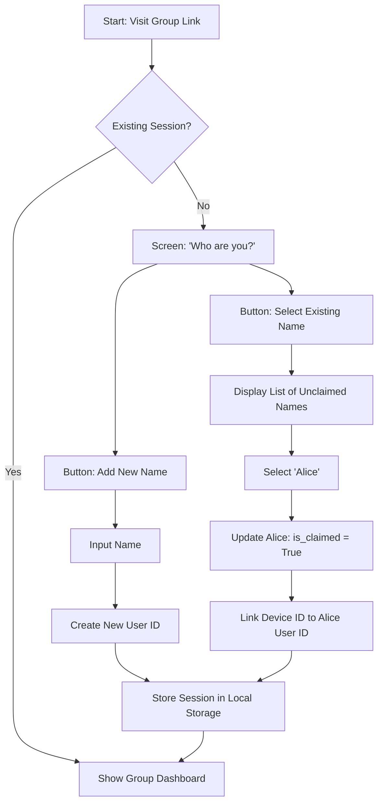

# Feature Specifications: Potluck

This document defines the logic and state transitions for complex features within the Potluck application.

---

## 1. Feature: Group Member Management (MVP)

**Problem:** In Splitwise, an organizer cannot assign an expense to someone who hasn't downloaded the app or created an account yet.
**Solution (current MVP scope):** Any participant with the group link can add a plain named member to the ledger — no email, phone number, or account required. Any member can then be selected as the payer or as a split participant on any expense.

### Logic Flow (as built)
1. **Creation:** From the ledger page, a user opens "Manage Users" and adds a name.
2. **Assignment:** That name immediately becomes selectable as a payer or split participant on any expense in the ledger — there is no separate join or activation step.
3. **No ownership/identity binding:** All members are equivalent, undifferentiated rows tied to the ledger (`is_placeholder` is always `true`). There is no concept of "this browser is Alice" — anyone with the link can add expenses on behalf of anyone in the list.

4. **Renaming:** any member can be renamed from "Manage Users".
5. **Removing:** removing a member does one of two things, decided atomically by the `remove_member()` database function:
   - **No activity** (not a payer, split participant, payer or payee of any payment): the member is deleted.
   - **Any activity:** the member is **archived** (`users.archived_at` set). They disappear from the payer, split and payment pickers for new records, but stay on every record they are already part of and in the balances, so the books still add up. An archived member can still owe or be owed money, and can still be settled up with: Settle up pre-fills them even though new payments would not offer them.

   Editing an existing expense or payment keeps its archived members in the pickers, so saving the edit cannot silently drop them.
6. **Restoring:** archived members are listed under "Removed" in "Manage Users" and can be restored, which makes them pickable again.

Removing someone never changes anyone's balance. Blocking removal while a member's balance is non-zero was considered and rejected: a mistaken addition would then be stuck in the group until someone settled a debt that should not exist.

This is intentionally simple for the MVP: it covers the core use case (a small trusted group splitting costs) without needing accounts or a join flow.

### Deferred (Post-MVP): "Claiming" / Identity Binding

**Out of scope for now.** The original design explored letting invitees "claim" a placeholder name via Local Storage session binding, tying a specific browser/device to a user row so historical expenses become "theirs." This has been deprioritized in favor of other MVP-critical work (see Split Logic validation and Payments below). The schema already reserves columns for this (`device_token`, `phone_number`, `auth_user_id` — see [db-chart.md](./db-chart.md)), but no app logic uses them yet.

If/when this is revisited, the original flow was:
1. Organizer adds placeholder names (no emails/phones); each defaults to unclaimed.
2. Organizer shares the group URL.
3. A new visitor without a stored session sees "Who are you?" — pick an existing unclaimed name, or add a new one.
4. Picking an existing name "claims" it and links the visitor's device to that user, making their historical expenses visible/editable to them.

---

## 2. Feature: Split Logic

**Core Principles**
* **Integer Arithmetic:** All calculations occur in the smallest currency unit (cents) to prevent floating-point processing errors.
* **Zero-Friction Default:** New expenses default to an Equal split among all group members.

**Split Modes**

The composer (the right-hand panel, or a full-height sheet on a phone) offers
four modes. The chosen mode is saved on the expense (`expenses.split_mode`),
and percentages and share counts are saved per person (`splits.weight`), so
editing reopens exactly what was entered. Rows saved before the Glow redesign
have no mode and reopen as Exact.

* **Equally:** pick who is included. The total is divided with integer
  division; leftover cents go one each to the first members in ledger order,
  and the composer says who takes them.
* **Exact:** type each person's amount. A helper splits whatever is left
  across the blank rows.
* **Percent:** type a percentage per person; they must total exactly 100.
* **Shares:** whole-number steppers (default 1 each); the total is divided in
  proportion.

Percent and Shares use the largest-remainder method, so every split sums
exactly to the total and the cents go to the largest fractional parts (ties in
ledger order). The arithmetic lives in `src/lib/glow/split.ts` and is shared
by every screen.

**Validation:** each mode shows a status strip ("Fully assigned", "CA$4.00
left to assign", "100% assigned") and the Save button states why it is
blocked until the split adds up. The server re-checks the total, membership
and weights in `save_expense()`.

## 3. Feature: Payments / Settlements

**Core Principle:** a payment is a transfer between two members — it names who
handed money over and who received it. It is not "money off what I owe": every
member's net sums to zero across the group, and crediting nobody would break
that, leaving creditors owed money the app never tells anyone to pay. See
[payments-design.md](./payments-design.md) for the full reasoning.

**Arithmetic.** A payment credits the payer and debits the payee by the same
amount, which is the same shape as an expense whose entire split lands on one
person. For the pairwise view it is an edge in the opposite direction, so the
existing mutual-cancellation step nets it off with no special casing:

* Paying part of a debt leaves the remainder.
* Overpaying reverses who is owed.
* Paying someone you owe nothing makes them your debtor.

**Recording a payment.** Two entry points:

* **Mark paid**, on each row of the Balances tab's settle-up plan. The debt on screen already
  names the payer, the payee and the amount, so the form opens filled in and
  the user only confirms. This is the intended path.
* **Add payment**, in the group header (or the phone action bar, or the P key), for payments that do not match
  a suggested transfer — someone rounded up, paid early, or paid a person they
  did not owe. No amount is validated against what is currently owed, because
  all three of those are legitimate.

With Simplify Debts on, the suggested transfers are not raw pairwise debts.
Settling a simplified transfer is still correct — the arithmetic does not care
— and is the point of simplification.

**Currency.** Payments are recorded in the ledger's base currency only, until
the exchange-rate work in [KNOWN-ISSUES.md](./KNOWN-ISSUES.md) §1.4 lands.
Editing an existing payment writes back that payment's own currency rather than
the ledger's current base, so changing the base later cannot silently relabel
what was already recorded.

**History.** Payments appear in the Activity ledger alongside expenses, in one
chronological order, tagged "Payment" and phrased from the viewer's side
("Matthew paid you", "You paid Alvin") with an "in"/"out" impact. A member's balance breakdown gains
"Payments made" and "Payments received" sections, so the four totals shown
still add up to the net above them.

**Editing and deleting.** Selecting a payment opens its details in the right
panel, with Edit and Delete. Deleting asks for confirmation inline, because
removing a settlement puts the debt back.
